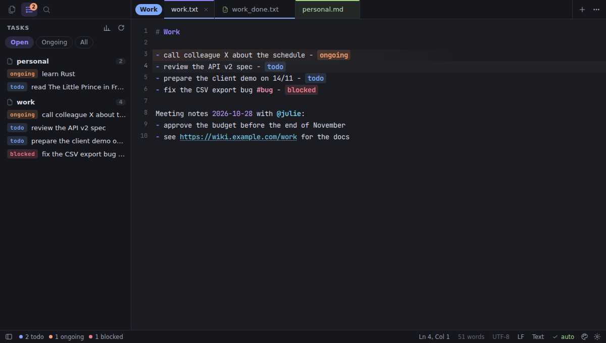
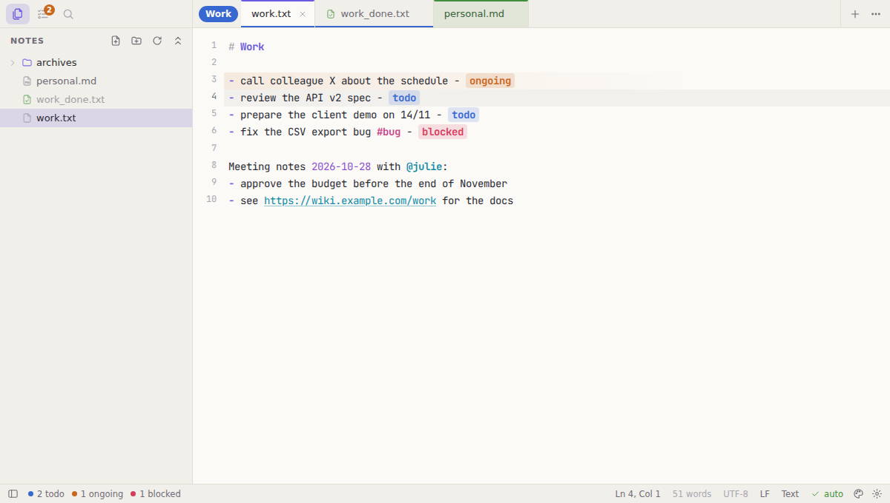
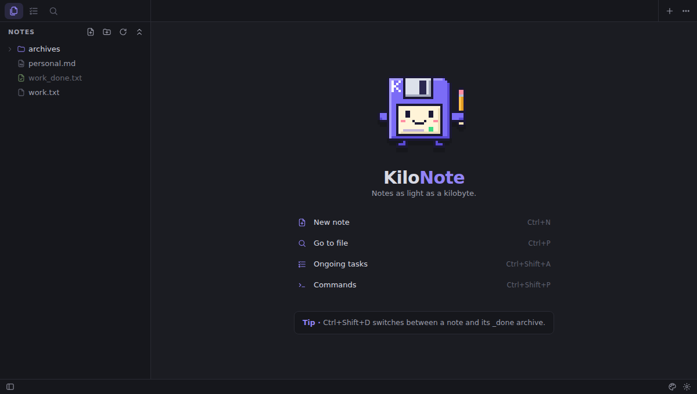

<p align="center">
  
</p>

<h1 align="center">KiloNote</h1>

<p align="center">
  <em>Notes as light as a kilobyte.</em><br>
  A fast, keyboard-driven note-taking app with built-in task tracking.
</p>

<p align="center">
  <a href="https://github.com/Damoy/kilonote/releases/latest"></a>
  <a href="https://github.com/Damoy/kilonote/actions/workflows/ci.yml"></a>
  <a href="LICENSE"></a>
  
</p>

KiloNote is a desktop note editor for Windows, macOS and Linux. It is minimal, fast and
fully usable from the keyboard, and it is built around one workflow: **tracking your work
tasks and keeping a history of what you got done**. Your notes stay plain text files that any
other tool can read.

Its mascot is **Kilo**, a pixel art floppy disk (the kilobyte, in person) with a terminal
line on its label. It is drawn pixel by pixel in
[`scripts/generate-icons.py`](scripts/generate-icons.py), which generates every icon.



<details>
<summary>More screenshots: Paper theme, welcome screen</summary>





</details>

## Quick start

1. [Install KiloNote](#install).
2. **Ctrl+Shift+O**: open the folder that holds your notes.
3. Type a line, then press **Ctrl+Enter**: it becomes a task (`todo` → `ongoing` → `done`).
4. **Ctrl+Shift+Enter**: the completed task moves, dated, to `<project>_done.txt`.
5. **Ctrl+Shift+P**: every command. **Ctrl+,**: every setting.

On macOS, use ⌘ instead of Ctrl.

## Features

**Editor**
- Fast even on large files (CodeMirror 6), multiple cursors (Ctrl+D, Alt+click), column selection
- Note highlighting: `#` headings, bullets, clickable links (Ctrl+click), dates, `#tags`, `@mentions`
- Markdown and JSON highlighting; UTF-8, Windows-1252 and UTF-16 files are read correctly, LF/CRLF line endings are kept
- Autosave, atomic writes, unsaved tabs kept between sessions
- Notes changed by another program are reloaded automatically (or you choose, if you have unsaved edits)

**Tasks**
- A task is a line ending with ` - <status>`: `- call colleague X - todo`
- **Ctrl+Enter** cycles the status: `todo` → `ongoing` → `done` (on one or several lines)
- **Click a status** to pick another one or archive the task
- **Ctrl+Shift+Enter** archives the task to `<project>_done.txt`, with the date: `- call colleague X - done [2026-11-02]`
- **Tasks view**: the tasks of all your notes in one place, ongoing ones first
- **Activity report**: a summary of the year by project and by month, ready for your yearly review

**Organization**
- Colored tabs and **tab groups** with a name and a color, collapsible; drag and drop
- File explorer, fuzzy file search (Ctrl+P), search in all files (Ctrl+Shift+F)
- Command palette (Ctrl+Shift+P), go to a heading or task (Ctrl+R), go to a line (Ctrl+G)

**Customization**
- 6 themes (Midnight, Paper, Forest, Ocean, Sand, Retro), or automatic based on the system
- Accent color, any theme color, font, size, line height
- Task statuses and their colors, the status cycle, the archive suffix, keyboard shortcuts: all in a commented `settings.json`
- Zen mode (Shift+F11), full screen (F11)

## Daily task tracking

```text
work.txt                                     work_done.txt
────────                                     ─────────────
# Work                                       - set up CI - done [2026-01-15]
- call colleague X - todo       Ctrl+Shift+  - migrate the database - ok [2026-03-02]
- review the spec - ongoing     Enter ────►  - call colleague X - done [2026-11-02]
```

1. Write the task, then **Ctrl+Enter**: ` - todo` is appended (on an empty line, a blank task is prepared).
2. When you start working on it: **Ctrl+Enter** → `ongoing`.
3. When it is done: **Ctrl+Shift+Enter** → the line moves to `work_done.txt`, stamped with today's date.
   **Ctrl+Shift+D** switches between `work.txt` and `work_done.txt`.
4. At the end of the year: command palette → **Report: Generate activity report**.

The statuses `todo`, `ongoing`, `blocked`, `wait`, `done` and `ok` are recognized out of the box,
in any case. Your existing files work as they are.

## Install

Download the installer for your system from the
[latest release](https://github.com/Damoy/kilonote/releases/latest). Each release also
publishes `SHA256SUMS.txt`, the checksums of every file.

### Windows

Run `KiloNote_<version>_x64-setup.exe`. It installs **without administrator rights**, into
`%LOCALAPPDATA%\KiloNote`, with Start menu and Desktop shortcuts. Open KiloNote, then
right-click its taskbar icon → **Pin to taskbar**. The `KiloNote.exe` produced by the build
scripts is also a portable version (nothing to install).

The app is not code-signed yet, so SmartScreen may warn you the first time:
*More info* → *Run anyway*.

### macOS

Open `KiloNote_<version>_universal.dmg` (Intel and Apple Silicon) and drag KiloNote to
Applications. The app is not signed: the first time, right-click KiloNote → *Open*
(or run `xattr -cr /Applications/KiloNote.app`).

### Linux

| Package | Install | Launch |
|---|---|---|
| `.deb` (Debian, Ubuntu, Mint…) | `sudo apt install ./KiloNote_<version>_amd64.deb` | from the app menu, or `kilonote` |
| `.rpm` (Fedora, openSUSE…) | `sudo dnf install ./KiloNote-<version>-1.x86_64.rpm` | from the app menu, or `kilonote` |
| `.AppImage` (any distribution) | `chmod +x KiloNote_<version>_amd64.AppImage` | `./KiloNote_<version>_amd64.AppImage` |

The AppImage needs FUSE 2: `sudo apt install libfuse2` (Ubuntu 22.04) or `libfuse2t64`
(Ubuntu 24.04+). Without it, run it with `--appimage-extract-and-run`.

To build it yourself on Linux, see [Build from source](#build-from-source).

### Using KiloNote at work

KiloNote is a plain local file editor: **no network access, no telemetry, no administrator
rights**. The executable is not signed, though, and installing software that is not in your
company's catalog may fall under its IT policy: ask your IT team first and give them the
[security sheet](docs/SECURITY.md). The published SHA-256 checksums let them allow this exact
file (AppLocker, EDR…).

## Keyboard shortcuts

On macOS, Ctrl becomes ⌘.

| Action | Shortcut |
|---|---|
| Task: next status | **Ctrl+Enter** |
| Task: archive to `_done` | **Ctrl+Shift+Enter** |
| Switch note ↔ archive | Ctrl+Shift+D |
| Tasks view | Ctrl+Shift+A |
| Go to file | Ctrl+P (`:` line, `@` headings and tasks, `>` commands) |
| Command palette | Ctrl+Shift+P or F1 |
| Go to heading or task | Ctrl+R |
| Go to line | Ctrl+G |
| Find / replace | Ctrl+F / Ctrl+H |
| Search in folder | Ctrl+Shift+F |
| New note / open file / open folder | Ctrl+N / Ctrl+O / Ctrl+Shift+O |
| Save / save as | Ctrl+S / Ctrl+Shift+S |
| Close / reopen a tab | Ctrl+W / Ctrl+Shift+T |
| Next tab / tab #N | Ctrl+Tab / Ctrl+1…9 |
| Sidebar / file explorer | Ctrl+B / Ctrl+Shift+E |
| Text size | Ctrl+= / Ctrl+- / Ctrl+0 (or Ctrl+wheel) |
| Settings | Ctrl+, |
| Zen mode / full screen | Shift+F11 / F11 |
| Select next occurrence | Ctrl+D |
| Move / delete line | Alt+↑↓ / Ctrl+Shift+K |

Every shortcut can be changed in `settings.json`:

```jsonc
"keybindings": {
  "Ctrl+T": "task.cycle",       // command ids are shown in the command palette
  "Ctrl+Shift+Enter": ""        // an empty value disables a shortcut
}
```

## Customization

**Ctrl+,** opens `settings.json`. Every option is documented in it, and saving applies the
changes immediately. For example:

```jsonc
{
  "theme": "paper",
  "accent": "#e8590c",
  "colors": { "bg": "#fffdf8" },
  "font_family": "Cascadia Code, monospace",
  "task_statuses": { "todo": "blue", "ongoing": "orange", "waiting": "purple", "done": "green", "ok": "green" },
  "task_cycle": ["todo", "ongoing", "done"],
  "archive_suffix": "_done",
  "archive_status": "ok",
  "archive_date": true
}
```

The file lives in `%APPDATA%\dev.damoy.kilonote\` (Windows),
`~/Library/Application Support/dev.damoy.kilonote/` (macOS) or `~/.config/dev.damoy.kilonote/` (Linux).

## Build from source

You need [Node.js](https://nodejs.org) 20+ and [Rust](https://rustup.rs) (stable), plus the
system dependencies of [Tauri](https://tauri.app/start/prerequisites/) for your platform.

| Command | Result |
|---|---|
| `npm run app:dev` | runs the app in development mode |
| `npm run app:build` | native build for the current system, in `src-tauri/target/release/bundle/` |
| `npm run build:windows` | Windows installer + portable exe (+ `SHA256SUMS.txt`) in `dist-windows/`, **from Linux or WSL** |
| `npm run install:windows` | same, then installs or updates KiloNote on Windows (from WSL): an open KiloNote keeps running, and the new build starts the next time you open it |
| `scripts\build-windows.ps1 [-Install]` | same, directly on Windows (PowerShell) |
| `npm run dev` | the interface alone in a browser, with demo notes |
| `npm test` | unit tests |
| `npm run icons` | regenerates every icon from the pixel art in `scripts/generate-icons.py` |

### Linux

Install the system dependencies, then build:

```bash
# Debian / Ubuntu
sudo apt install libwebkit2gtk-4.1-dev build-essential curl wget file libxdo-dev libssl-dev libayatana-appindicator3-dev librsvg2-dev
# Fedora
sudo dnf install webkit2gtk4.1-devel openssl-devel curl wget file libappindicator-gtk3-devel librsvg2-devel libxdo-devel
sudo dnf group install c-development
# Arch
sudo pacman -S --needed webkit2gtk-4.1 base-devel curl wget file openssl libappindicator-gtk3 librsvg xdotool

npm ci
npm run app:build
sudo apt install ./src-tauri/target/release/bundle/deb/KiloNote_*_amd64.deb   # or the .rpm / .AppImage next to it
```

### Windows

- **From WSL or Linux (recommended, nothing to install on Windows)**: `npm run build:windows`.
  The first run of `scripts/setup-windows-cross.sh` sets up cross-compilation without root
  rights: the Rust Windows target, `cargo-xwin` (which downloads Microsoft's Windows
  libraries), LLVM and NSIS, extracted into `~/.local/share/kilonote-toolchain`.
- **On Windows**: Node.js, Rust and the Visual Studio C++ Build Tools (the `winget`
  commands are in the script's help: `Get-Help scripts\build-windows.ps1`), then
  `scripts\build-windows.ps1`.

### macOS

`xcode-select --install`, then `npm ci && npm run app:build`.

You can pass a folder or a file as an argument: `kilonote ~/notes` or `KiloNote.exe C:\notes`.
If KiloNote is already open, the existing window comes to the front and opens it.

## Release a new version

```bash
npm run release -- patch            # 0.1.0 → 0.1.1   (minor: 0.2.0, major: 1.0.0, or an explicit 1.4.2)
npm run release -- patch --dry-run  # shows what would happen
```

The script checks that everything is committed, bumps the version everywhere, runs the tests,
creates the `Version X.Y.Z` commit and the `vX.Y.Z` tag, then pushes to GitHub. GitHub
Actions then builds the installers for the three systems and publishes them, with their
checksums, in the release. With `--local`, the Windows installer is built on your machine and
published right away with the [GitHub CLI](https://cli.github.com).

## Development

```
src/
  core/         backend (Tauri or browser demo), paths, settings, themes, commands
  editor/       CodeMirror: tasks (pure logic), note highlighting, setup
  ui/           tabs and tab groups, sidebar, palette, menus, status bar, welcome screen
  app.ts        controller: documents, saving, session, commands
  report.ts     activity report
src-tauri/      native Rust backend: atomic reads/writes, archives, trash, single instance
scripts/        Windows builds (WSL or PowerShell), releases, pixel art icon generation
docs/           security sheet, screenshots
```

Technical choices: [Tauri 2](https://tauri.app) (native window, an installer of about 2 MB
instead of ~100 MB for Electron), [CodeMirror 6](https://codemirror.net) for the editor, and
no UI framework.

## Credits

- [Tauri](https://tauri.app) (MIT / Apache-2.0) and [CodeMirror](https://codemirror.net) (MIT)
- [JetBrains Mono](https://www.jetbrains.com/lp/mono/) font (SIL Open Font License 1.1), bundled through [Fontsource](https://fontsource.org)

## License

[MIT](LICENSE) © 2026 Damoy
