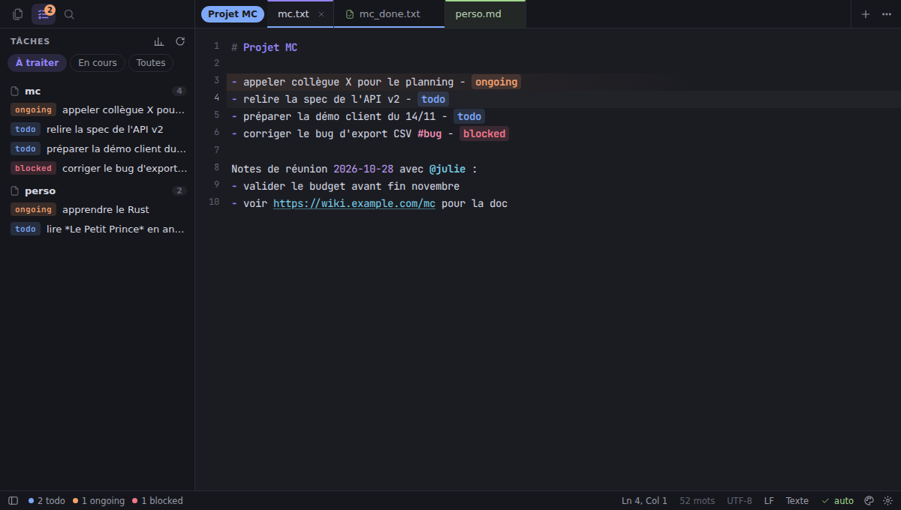
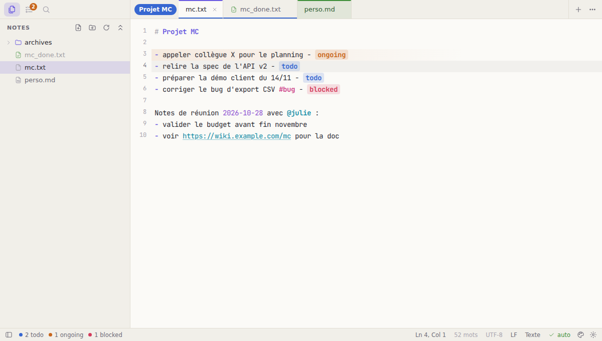
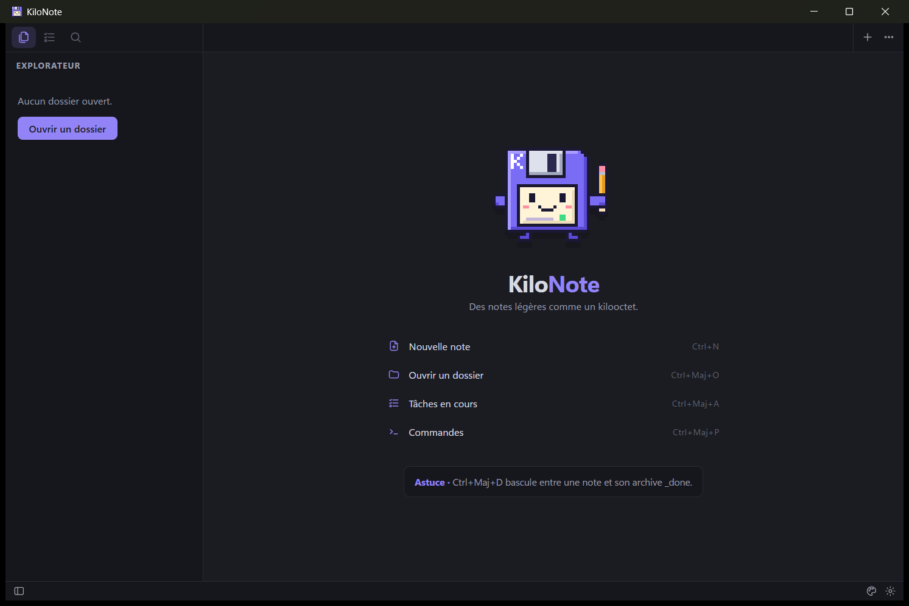

<p align="center">
  
</p>

<h1 align="center">KiloNote</h1>

<p align="center"><em>Des notes légères comme un kilooctet.</em></p>

KiloNote est un éditeur de notes pour Windows, macOS et Linux, dans l'esprit de Sublime Text :
sobre, rapide, entièrement au clavier, et pensé pour **suivre ses tâches de travail** et en
garder l'historique. Vos notes restent de simples fichiers texte, lisibles partout.

Sa mascotte s'appelle **Kilo** : une disquette en pixel art (le kilo-octet incarné), avec une
ligne de terminal sur son étiquette. Elle est dessinée pixel par pixel dans
[`scripts/generate-icons.py`](scripts/generate-icons.py), qui produit toutes les icônes.



<details>
<summary>Thème clair « Papier » et application Windows</summary>





</details>

---

## Démarrage rapide

1. Installez KiloNote : `KiloNote_x.y.z_x64-setup.exe` (Windows, sans droits administrateur).
2. **Ctrl+Maj+O** : ouvrez le dossier qui contient vos notes.
3. Écrivez une ligne puis **Ctrl+Entrée** : c'est une tâche (`todo` → `ongoing` → `done`).
4. **Ctrl+Maj+Entrée** : la tâche terminée part, datée, dans `<projet>_done.txt`.
5. **Ctrl+Maj+P** : toutes les commandes. **Ctrl+,** : tous les réglages.

## Fonctionnalités

**Éditeur**
- Rapide même sur de gros fichiers (CodeMirror 6), multi-curseurs (Ctrl+D, Alt+clic), sélection en colonne
- Coloration des notes : titres `#`, puces, liens cliquables (Ctrl+clic), dates, `#tags`, `@mentions`
- Markdown et JSON colorés ; encodages UTF-8, Windows-1252 et UTF-16 reconnus, fins de ligne LF/CRLF conservées
- Enregistrement automatique, écriture atomique, onglets non enregistrés conservés entre deux sessions
- Rechargement automatique quand un autre programme modifie une note ouverte

**Tâches**
- Une tâche est une ligne qui se termine par ` - <statut>` : `- appeler collègue X - todo`
- **Ctrl+Entrée** fait tourner le statut : `todo` → `ongoing` → `done` (sur une ou plusieurs lignes)
- **Clic sur un statut** : menu pour le changer ou archiver la tâche
- **Ctrl+Maj+Entrée** archive la tâche dans `<projet>_done.txt`, datée : `- appeler collègue X - done [2026-11-02]`
- Vue **Tâches** : toutes les tâches de toutes vos notes, celles en cours d'abord
- **Bilan d'activité** : résumé de l'année par projet et par mois, prêt à présenter à son manager

**Organisation**
- Onglets colorés et **groupes d'onglets** nommés, colorés et repliables ; glisser-déposer
- Explorateur de dossier, recherche floue de fichiers (Ctrl+P), recherche dans tous les fichiers (Ctrl+Maj+F)
- Palette de commandes (Ctrl+Maj+P), aller à un titre ou une tâche (Ctrl+R), à une ligne (Ctrl+G)

**Personnalisation**
- 6 thèmes (Minuit, Papier, Forêt, Océan, Sable, Rétro) ou automatique selon le système
- Couleur d'accent, surcharge de chaque couleur, police, taille, interligne
- Statuts de tâches, couleurs, cycle, suffixe d'archive, raccourcis clavier : tout est dans un `settings.json` commenté
- Mode zen (Maj+F11), plein écran (F11)

## Le suivi des tâches au quotidien

```text
mc.txt                                         mc_done.txt
──────                                         ───────────
# Projet MC                                    - mettre en place la CI - done [2026-01-15]
- appeler collègue X - todo        Ctrl+Maj+   - migrer la base - ok [2026-03-02]
- relire la spec - ongoing         Entrée ──►  - appeler collègue X - done [2026-11-02]
```

1. Écrivez la tâche, puis **Ctrl+Entrée** : ` - todo` est ajouté (sur une ligne vide, une tâche vierge est préparée).
2. Quand vous commencez : **Ctrl+Entrée** → `ongoing`.
3. Quand c'est fini : **Ctrl+Maj+Entrée** → la ligne part dans `mc_done.txt` avec la date du jour.
   **Ctrl+Maj+D** bascule entre `mc.txt` et `mc_done.txt`.
4. En fin d'année : palette → **Bilan : générer le bilan d'activité**.

Les statuts `todo`, `ongoing`, `blocked`, `wait`, `done`, `ok` sont reconnus par défaut, en
majuscules ou minuscules. Vos fichiers existants fonctionnent tels quels.

## Installation

### Windows

Lancez `KiloNote_x.y.z_x64-setup.exe` : l'installation se fait **sans droits administrateur**,
dans `%LOCALAPPDATA%\KiloNote`, avec un raccourci dans le menu Démarrer. Ouvrez KiloNote puis
clic droit sur son icône dans la barre des tâches → **Épingler à la barre des tâches**.
Le fichier `KiloNote.exe` seul est aussi une version portable (rien à installer).

L'application n'étant pas signée numériquement, SmartScreen peut afficher un avertissement :
*Informations complémentaires* → *Exécuter quand même*.

### macOS et Linux

Les installeurs (`.dmg`, `.AppImage`, `.deb`, `.rpm`) sont produits par GitHub Actions et
publiés dans les *Releases* du dépôt. Sur macOS, la première fois : clic droit sur KiloNote →
*Ouvrir* (application non signée).

### Au travail

KiloNote est un simple éditeur de fichiers locaux : **aucun accès réseau, aucune télémétrie,
aucun droit administrateur**. L'exécutable n'est toutefois pas signé, et installer un logiciel
hors catalogue peut relever de la charte informatique de votre entreprise : demandez l'accord
de votre service informatique en lui transmettant la [fiche sécurité](docs/SECURITE.md).
Chaque version est livrée avec ses empreintes SHA-256 (`SHA256SUMS.txt`), ce qui permet
d'autoriser précisément ce fichier (AppLocker, EDR…).

## Construire

| Commande | Effet |
|---|---|
| `npm run build:windows` | installeur + exe portable Windows (+ `SHA256SUMS.txt`) dans `dist-windows/`, **depuis Linux ou WSL** |
| `npm run install:windows` | idem, puis installe/met à jour KiloNote sous Windows (depuis WSL) |
| `scripts\build-windows.ps1 [-Install]` | même chose, directement sous Windows (PowerShell) |
| `npm run app:build` | build natif pour le système courant |
| `npm run app:dev` | application en mode développement |
| `npm run dev` | interface seule dans le navigateur, avec des notes de démonstration |
| `npm test` | tests unitaires |
| `npm run icons` | régénère toutes les icônes depuis le pixel art de `scripts/generate-icons.py` |

**Depuis WSL/Linux (recommandé, rien à installer sous Windows)** : il faut Node.js et
[Rust](https://rustup.rs). Au premier lancement, `scripts/setup-windows-cross.sh` prépare la
compilation croisée : cible Rust Windows, `cargo-xwin` (qui télécharge les bibliothèques
Windows de Microsoft), LLVM et NSIS — extraits dans `~/.local/share/kilonote-toolchain`, sans
droits root.

**Sous Windows** : Node.js, Rust et les Build Tools C++ de Visual Studio (commandes `winget`
dans l'aide du script : `Get-Help scripts\build-windows.ps1`).

**Linux natif** : `sudo apt install libwebkit2gtk-4.1-dev build-essential libssl-dev libayatana-appindicator3-dev librsvg2-dev`
puis `npm run app:build`.

On peut passer un dossier ou un fichier en argument : `KiloNote.exe C:\notes`. Si KiloNote est
déjà ouvert, la fenêtre existante revient au premier plan et ouvre le fichier.

## Publier une nouvelle version

```bash
npm run release -- patch      # 0.1.0 → 0.1.1   (minor : 0.2.0, major : 1.0.0, ou 1.4.2)
npm run release -- patch --dry-run   # pour voir ce qui serait fait
```

Le script vérifie que tout est commité, met la version à jour partout, lance les tests,
crée le commit « Version X.Y.Z » et le tag `vX.Y.Z`, puis pousse sur GitHub. GitHub Actions
construit alors les installeurs des trois systèmes et les publie dans la release.
Avec `--local`, l'installeur Windows est construit sur votre machine et publié immédiatement
via [GitHub CLI](https://cli.github.com) (`gh auth login` au préalable).

Prérequis : un dépôt GitHub configuré comme `origin`
(`git remote add origin git@github.com:<vous>/kilonote.git && git push -u origin main`).

## Raccourcis

Sur macOS, Ctrl devient ⌘.

| Action | Raccourci |
|---|---|
| Tâche : statut suivant | **Ctrl+Entrée** |
| Tâche : archiver dans `_done` | **Ctrl+Maj+Entrée** |
| Basculer note ↔ archive | Ctrl+Maj+D |
| Vue des tâches | Ctrl+Maj+A |
| Aller au fichier | Ctrl+P (`:` ligne, `@` titres/tâches, `>` commandes) |
| Palette de commandes | Ctrl+Maj+P ou F1 |
| Aller à un titre / une tâche | Ctrl+R |
| Aller à la ligne | Ctrl+G |
| Rechercher / remplacer | Ctrl+F / Ctrl+H |
| Rechercher dans le dossier | Ctrl+Maj+F |
| Nouvelle note / ouvrir / dossier | Ctrl+N / Ctrl+O / Ctrl+Maj+O |
| Enregistrer / sous | Ctrl+S / Ctrl+Maj+S |
| Fermer / rouvrir un onglet | Ctrl+W / Ctrl+Maj+T |
| Onglet suivant / n°X | Ctrl+Tab / Ctrl+1…9 |
| Barre latérale / explorateur | Ctrl+B / Ctrl+Maj+E |
| Taille du texte | Ctrl+= / Ctrl+- / Ctrl+0 (ou Ctrl+molette) |
| Paramètres | Ctrl+, |
| Mode zen / plein écran | Maj+F11 / F11 |
| Sélectionner l'occurrence suivante | Ctrl+D |
| Déplacer / supprimer la ligne | Alt+↑↓ / Ctrl+Maj+K |

Tous les raccourcis se redéfinissent dans `settings.json` :

```jsonc
"keybindings": {
  "Ctrl+T": "task.cycle",     // id visible dans la palette de commandes
  "Ctrl+Maj+Enter": ""        // une valeur vide désactive le raccourci
}
```

## Personnalisation

**Ctrl+,** ouvre `settings.json`. Chaque option y est documentée ; l'enregistrement applique
les changements immédiatement. Exemples :

```jsonc
{
  "theme": "papier",
  "accent": "#e8590c",
  "colors": { "bg": "#fffdf8" },
  "font_family": "Cascadia Code, monospace",
  "task_statuses": { "todo": "blue", "ongoing": "orange", "attente": "purple", "done": "green", "ok": "green" },
  "task_cycle": ["todo", "ongoing", "done"],
  "archive_suffix": "_done",
  "archive_status": "ok",
  "archive_date": true
}
```

Emplacement du fichier : `%APPDATA%\dev.damoy.kilonote\` (Windows),
`~/Library/Application Support/dev.damoy.kilonote/` (macOS), `~/.config/dev.damoy.kilonote/` (Linux).

## Développement

Architecture :

```
src/
  core/         backend (Tauri ou démo navigateur), chemins, paramètres, thèmes, commandes
  editor/       CodeMirror : tâches (logique pure), coloration des notes, configuration
  ui/           onglets et groupes, barre latérale, palette, menus, barre d'état, accueil
  app.ts        contrôleur : documents, enregistrement, session, commandes
  report.ts     bilan d'activité
src-tauri/      backend natif Rust : lecture/écriture atomique, archives, corbeille, instance unique
scripts/        build Windows (WSL ou PowerShell), publication, génération des icônes pixel art
```

Choix techniques : [Tauri 2](https://tauri.app) (fenêtre native, ~10 Mo au lieu de ~150 Mo pour
Electron), [CodeMirror 6](https://codemirror.net) pour l'éditeur, aucun framework d'interface.
