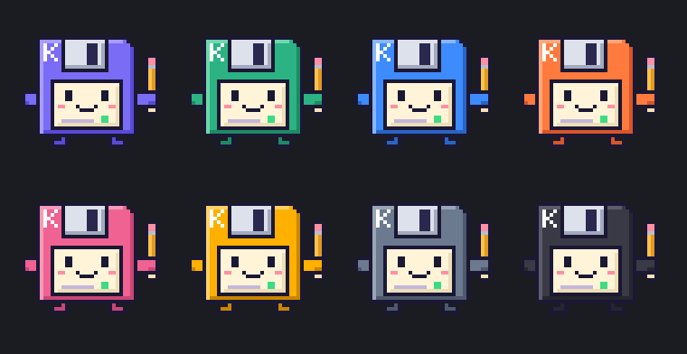

<p align="center">
  
</p>

<h1 align="center">KiloNote</h1>

<p align="center">
  <em>Notes as light as a kilobyte.</em><br>
  A fast, keyboard-driven note-taking app with built-in task tracking.
</p>

<p align="center">
  <a href="https://github.com/Damoy/kilonote/releases/latest"></a>
  <a href="https://github.com/Damoy/kilonote/actions/workflows/ci.yml"></a>
  <a href="LICENSE"></a>
  
</p>

KiloNote is a desktop note editor for Windows, macOS and Linux. It is minimal, fast and
fully usable from the keyboard, and it is built around one workflow: **tracking your work
tasks and keeping a history of what you got done**. Your notes stay plain text files that any
other tool can read.

Its mascot is **Kilo**, a pixel art floppy disk (the kilobyte, in person) with a terminal
line on its label. It is drawn pixel by pixel in
[`scripts/generate-icons.py`](scripts/generate-icons.py), which generates every icon and the
[logo pack](#logo-pack). In the app, Kilo takes the color of your theme.


<details>
<summary>More screenshots: Paper theme, welcome screen</summary>


</details>

## Quick start

1. [Install KiloNote](#install).
2. **Ctrl+Shift+O**: open the folder that holds your notes.
3. Type a line, then press **Ctrl+Enter**: it becomes a task (`todo` → `ongoing` → `done`).
4. **Ctrl+Shift+Enter**: the completed task moves, dated, to `<project>_done.txt`.
5. **Ctrl+Shift+P**: every command. **Ctrl+,**: every setting.

On macOS, use ⌘ instead of Ctrl. The [`examples/`](examples) folder has a file for each
view (Markdown, HTML and SVG previews, JSON and YAML trees, formatting, syntax coloring):
open it as a folder and follow its `README.md`.

## Features

**Editor**
- Fast even on large files (CodeMirror 6), multiple cursors (Ctrl+D, Alt+click), column selection
- Note highlighting: `#` headings, bullets, clickable links (Ctrl+click), dates, `#tags`, `@mentions`
- A second view next to the editor (Ctrl+Shift+V, or the button that shows up at the right of
  the tabs); drag the separator to resize the pane, or show it alone:
  - live **Markdown preview**, with ` ```mermaid ` blocks drawn as diagrams;
  - **HTML and SVG preview**, in a sandbox (no script runs, nothing is loaded from the network);
    the text of a page can be **edited right in the preview** (the HTML follows, escaped);
  - an editable **tree view** for **JSON, YAML and XML** (hover a node to see it in the text,
    double-click a value or a key to change it, the tree follows the cursor);
  - **Mermaid diagrams** (`.mmd`: flowcharts, sequence, class, state, entity-relationship,
    Gantt, mind maps…), with zoom and *Save as SVG*;
  - for **SQL** files: the schema as an entity-relationship diagram (from `CREATE TABLE` and
    foreign keys), the tables and their columns, the rows of `INSERT` statements as grids, and
    the list of statements (a click goes there). Nothing is ever run against a database.
- **Syntax coloring** for about 40 languages and config formats (Python, JavaScript, TypeScript,
  C#, Java, C/C++, Go, Rust, SQL, PowerShell, Batch, Shell, YAML, TOML, INI, XML, HTML, CSS…),
  loaded only when such a file is opened; the status bar changes the document type
- **Format document** (Shift+Alt+F): JSON (comments and blank lines kept), XML, HTML, CSS, SQL
  (one clause per line, keywords in capitals) and Markdown tables, or just the selection (some
  JSON pasted in a note); *Edit: Minify JSON*
- Files keep their encoding (UTF-8, UTF-8 with BOM, UTF-16, Windows-1252) and their LF/CRLF line endings;
  the status bar converts them on demand
- **Images in notes**: paste a screenshot (Ctrl+V) in a `.txt` or `.md` note: it is saved
  next to the note (`images/`) and shown right under its line, ``;
  the note stays plain text
- Click a line number to select the whole line, without its line break (drag for more,
  Shift+click to extend);
  **Ctrl+↑/↓** moves the cursor and scrolls the text with it
- **Where else it appears**: select some text and the status bar tells how many times it
  appears in the whole note (or "only here"); the other occurrences are highlighted and
  marked along the scrollbar, **Ctrl+F3** goes to the next one. Find (Ctrl+F) counts its
  matches as you type: "3 of 12"
- Autosave, atomic writes, unsaved tabs kept between sessions
- Notes changed by another program are reloaded automatically (or you choose, if you have unsaved edits)
- **Local history**: whenever a version is about to be thrown away (overwriting a file changed
  elsewhere, reloading over unsaved edits, replacing in files), a copy is kept: *File: Local history*
- Large files ask before opening (over 20 MB); binary files are never opened as text

**Tasks**
- A task is a line ending with ` - <status>`: `- call colleague X - todo`
- **Ctrl+Enter** cycles the status: `todo` → `ongoing` → `done` (on one or several lines)
- **Click a status** to pick another one or archive the task
- **Ctrl+Shift+Enter** archives the task to `<project>_done.txt`, with the date: `- call colleague X - done [2026-11-02]`
- **Due dates**: `- send the report @2026-11-14 - todo`, or **Ctrl+Shift+U** (today, tomorrow,
  next Monday, `14/11`, `+3`, `2w`…); overdue tasks turn red
- **Tasks view**: the tasks of all your notes in one place, ongoing ones first; filters
  *Open*, *Ongoing*, *Due* and by `#tag`; the badge counts overdue tasks
- **Activity report**: a summary by project and by month, for this or last week, month or year,
  the last 12 months or all time, optionally limited to one `#tag` (a client, a topic…)

**Organization**
- **Several windows** (Ctrl+Shift+N), each with its own tabs and folder; drag a tab onto another
  window (or out of the window to open a new one); every window comes back at the next launch
- Colored tabs and **tab groups** with a name and a color; click a group to collapse it into a
  compact stack (only the tab being edited stays visible), click again to expand it; drag and
  drop; a list of all tabs when they no longer fit
- Sidebar and folder can be closed from their own buttons (or Ctrl+B)
- File explorer with file type icons; the header button collapses every folder (or expands
  them all when none is open), and the button that appears over a folder expands or collapses
  everything inside it (Alt+click a folder does the same)
- Fuzzy file search (Ctrl+P), search and **replace in all files** (Ctrl+Shift+F, with undo)
- Command palette (Ctrl+Shift+P), go to a heading or task (Ctrl+R), go to a line (Ctrl+G)

**Customization**
- 15 themes: Midnight, Forest, Ocean, Retro, Dusk, Slate, Abyss, Neon, Ember (dark);
  Paper, Sand, Mint, Sakura, Latte, Frost (light); or automatic based on the system
- Kilo, the mascot, takes the theme's accent color, or one of the [logo pack](#logo-pack) colors
- Four **icon packs**: Line, Bold, Duotone (file types in color) and Pixel (pixel art, like Kilo)
- A **cheat sheet** of the shortcuts at startup (until you tick *Don't show at startup*), and
  any time from the keyboard button of the status bar or Ctrl+?
- A **settings screen** (Ctrl+,): theme, accent color, fonts and sizes, editor, files, task
  statuses and their colors, archive options, shortcuts
- Everything is also in a commented `settings.json` (any theme color, custom shortcuts…)
- Zen mode (Shift+F11), full screen (F11)
- Readable in every theme: text and colors meet the WCAG contrast ratios (checked by the
  tests), and keyboard focus is always shown

## Daily task tracking

```text
work.txt                                     work_done.txt
────────                                     ─────────────
# Work                                       - set up CI - done [2026-01-15]
- call colleague X - todo       Ctrl+Shift+  - migrate the database - ok [2026-03-02]
- review the spec - ongoing     Enter ────►  - call colleague X - done [2026-11-02]
```

1. Write the task, then **Ctrl+Enter**: ` - todo` is appended (on an empty line, a blank task is prepared).
2. When you start working on it: **Ctrl+Enter** → `ongoing`.
3. When it is done: **Ctrl+Shift+Enter** → the line moves to `work_done.txt`, stamped with today's date.
   **Ctrl+Shift+D** switches between `work.txt` and `work_done.txt`.
4. Give it a deadline if needed: **Ctrl+Shift+U** → `@2026-11-14`; it turns red once overdue.
5. At the end of the week or the year: command palette → **Report: Generate activity report**
   (or **Report: Generate activity report for a #tag** to sum up one client or topic).

The statuses `todo`, `ongoing`, `blocked`, `wait`, `done` and `ok` are recognized out of the box,
in any case. Your existing files work as they are.

## Install

Download the installer for your system from the
[latest release](https://github.com/Damoy/kilonote/releases/latest). Each release also
publishes `SHA256SUMS.txt`, the checksums of every file.

### Windows

Run `KiloNote_<version>_x64-setup.exe`. It installs **without administrator rights**, into
`%LOCALAPPDATA%\KiloNote`, with Start menu and Desktop shortcuts. Open KiloNote, then
right-click its taskbar icon → **Pin to taskbar**. `KiloNote_<version>_x64-portable.exe` is a
portable version (a single file, nothing to install).

With [Scoop](https://scoop.sh) (portable version, per-user, with a Start menu shortcut):

```powershell
scoop install https://raw.githubusercontent.com/Damoy/kilonote/main/packaging/scoop/kilonote.json
```

`scoop update kilonote` then brings new versions. Manifests for
[winget](https://learn.microsoft.com/windows/package-manager/) are in
[`packaging/winget`](packaging/winget) (per-user installer, silent install supported).

To open text files with KiloNote from Explorer: right-click a file → *Open with* →
*Choose another app* → *Choose an app on your PC* → `kilonote.exe` (in
`%LOCALAPPDATA%\KiloNote`, or wherever you put the portable exe), and tick *Always* if you
want double-clicks to open it in KiloNote. Windows records that choice itself: neither the
installer nor the app writes file associations.

The app is not code-signed yet, so SmartScreen may warn you the first time:
*More info* → *Run anyway*.

### macOS

Open `KiloNote_<version>_universal.dmg` (Intel and Apple Silicon) and drag KiloNote to
Applications. The app is not signed: the first time, right-click KiloNote → *Open*
(or run `xattr -cr /Applications/KiloNote.app`). KiloNote then appears in the Finder's
**Open with** menu for text and Markdown files, without becoming the default app.

### Linux

| Package | Install | Launch |
|---|---|---|
| `.deb` (Debian, Ubuntu, Mint…) | `sudo apt install ./KiloNote_<version>_amd64.deb` | from the app menu, or `kilonote` |
| `.rpm` (Fedora, openSUSE…) | `sudo dnf install ./KiloNote-<version>-1.x86_64.rpm` | from the app menu, or `kilonote` |
| `.AppImage` (any distribution) | `chmod +x KiloNote_<version>_amd64.AppImage` | `./KiloNote_<version>_amd64.AppImage` |

The AppImage needs FUSE 2: `sudo apt install libfuse2` (Ubuntu 22.04) or `libfuse2t64`
(Ubuntu 24.04+). Without it, run it with `--appimage-extract-and-run`.

The `.deb` and `.rpm` packages register KiloNote for text and Markdown files, so it shows up
in your file manager's *Open with* menu.

To build it yourself on Linux, see [Build from source](#build-from-source).

### Using KiloNote at work

KiloNote is a plain local file editor: **no network access, no telemetry, no administrator
rights, and it never runs other programs** (a non-text file can only be revealed in the file
manager). The executable is not signed, though, and installing software that is not in your
company's catalog may fall under its IT policy: ask your IT team first and give them the
[security sheet](docs/SECURITY.md), which lists everything the program and the installer do.

On a managed PC, prefer:
- the **portable exe** (a single file, no installer, nothing written to the registry), or
- **building it yourself** from the sources in a Command Prompt, with no script and no
  download of an executable: `npm ci --ignore-scripts` then `npx tauri build --no-bundle`
  ([details](docs/SECURITY.md#building-from-source-on-a-managed-pc)).

The published SHA-256 checksums let your IT team allow the exact file, and every release
file carries a signed build provenance: `gh attestation verify <file> -R Damoy/kilonote`.

## Keyboard shortcuts

On macOS, Ctrl becomes ⌘.

| Action | Shortcut |
|---|---|
| Task: next status | **Ctrl+Enter** |
| Task: archive to `_done` | **Ctrl+Shift+Enter** |
| Switch note ↔ archive | Ctrl+Shift+D |
| Tasks view | Ctrl+Shift+A |
| Go to file | Ctrl+P (`:` line, `@` headings and tasks, `>` commands) |
| Command palette | Ctrl+Shift+P or F1 |
| Go to heading or task | Ctrl+R |
| Go to line | Ctrl+G |
| Find / replace | Ctrl+F / Ctrl+H |
| Search (and replace) in folder | Ctrl+Shift+F |
| Task: set due date | Ctrl+Shift+U |
| Preview (Markdown, HTML, SVG) / tree view (JSON, YAML) | Ctrl+Shift+V |
| Format document (JSON, XML, HTML, CSS, SQL, tables) | Shift+Alt+F |
| Shortcuts cheat sheet | Ctrl+? |
| New note / open file / open folder | Ctrl+N / Ctrl+O / Ctrl+Shift+O |
| New window | Ctrl+Shift+N |
| Save / save as | Ctrl+S / Ctrl+Shift+S |
| Close / reopen a tab | Ctrl+W / Ctrl+Shift+T |
| Next tab / tab #N | Ctrl+Tab / Ctrl+1…9 |
| Sidebar / file explorer | Ctrl+B / Ctrl+Shift+E |
| Text size | Ctrl+= / Ctrl+- / Ctrl+0 (or Ctrl+wheel) |
| Settings | Ctrl+, |
| Zen mode / full screen | Shift+F11 / F11 |
| Select next occurrence | Ctrl+D |
| Go to the next / previous occurrence of the selected text | Ctrl+F3 / Ctrl+Shift+F3 |
| Select a whole line | click its number (drag for more lines) |
| Move the cursor with the view | Ctrl+↑↓ |
| Move / duplicate / delete line | Alt+↑↓ / Shift+Alt+↑↓ / Ctrl+Shift+K |
| Paste an image in a note | Ctrl+V |

Every shortcut can be changed in `settings.json`:

```jsonc
"keybindings": {
  "Ctrl+T": "task.cycle",       // command ids are shown in the command palette
  "Ctrl+Shift+Enter": ""        // an empty value disables a shortcut
}
```

## Customization

**Ctrl+,** opens the settings screen; every change applies at once. Everything is stored in
`settings.json` (*Open settings.json* in the settings screen, or *Preferences: Open
settings.json* in the command palette), where every option is documented and saving applies
the changes immediately. For example:

```jsonc
{
  "theme": "paper",
  "accent": "#e8590c",
  "icon_pack": "pixel",
  "colors": { "bg": "#fffdf8" },
  "font_family": "Cascadia Code, monospace",
  "task_statuses": { "todo": "blue", "ongoing": "orange", "waiting": "purple", "done": "green", "ok": "green" },
  "task_cycle": ["todo", "ongoing", "done"],
  "task_ongoing_statuses": ["ongoing"],
  "task_blocked_statuses": ["blocked", "waiting"],
  "archive_suffix": "_done",
  "archive_status": "ok",
  "archive_date": true
}
```

The file lives in `%APPDATA%\dev.damoy.kilonote\` (Windows),
`~/Library/Application Support/dev.damoy.kilonote/` (macOS) or `~/.config/dev.damoy.kilonote/` (Linux).

## Build from source

You need [Node.js](https://nodejs.org) 20+ and [Rust](https://rustup.rs) (stable), plus the
system dependencies of [Tauri](https://tauri.app/start/prerequisites/) for your platform.

| Command | Result |
|---|---|
| `npm run app:dev` | runs the app in development mode |
| `npm run app:build` | native build for the current system, in `src-tauri/target/release/bundle/` |
| `npm run build:windows` | Windows installer + portable exe (+ `SHA256SUMS.txt`) in `dist-windows/`, **from Linux or WSL** |
| `npm run install:windows` | same, then updates the installed KiloNote (from WSL, see below) |
| `scripts\build-windows.ps1 [-Install]` | same, directly on Windows (PowerShell) |
| `npm run dev` | the interface alone in a browser, with demo notes |
| `npm test` | unit and behavior tests (the whole interface on an in-memory disk) |
| `npm run test:e2e` | end-to-end tests of the real app through WebDriver (run in CI on Linux, see `e2e/`) |
| `npm run icons` | regenerates every icon and the logo pack from the pixel art in `scripts/generate-icons.py` |

### Linux

Install the system dependencies, then build:

```bash
# Debian / Ubuntu
sudo apt install libwebkit2gtk-4.1-dev build-essential curl wget file libxdo-dev libssl-dev libayatana-appindicator3-dev librsvg2-dev
# Fedora
sudo dnf install webkit2gtk4.1-devel openssl-devel curl wget file libappindicator-gtk3-devel librsvg2-devel libxdo-devel
sudo dnf group install c-development
# Arch
sudo pacman -S --needed webkit2gtk-4.1 base-devel curl wget file openssl libappindicator-gtk3 librsvg xdotool

npm ci --ignore-scripts
npm run app:build
sudo apt install ./src-tauri/target/release/bundle/deb/KiloNote_*_amd64.deb   # or the .rpm / .AppImage next to it
```

### Windows

- **From WSL or Linux (recommended, nothing to install on Windows)**: `npm run build:windows`.
  The first run of `scripts/setup-windows-cross.sh` sets up cross-compilation without root
  rights: the Rust Windows target, `cargo-xwin` (which downloads Microsoft's Windows
  libraries), LLVM and NSIS, extracted into `~/.local/share/kilonote-toolchain`.
- **On Windows**: Node.js, Rust and the Visual Studio C++ Build Tools (the `winget`
  commands are in the script's help: `Get-Help scripts\build-windows.ps1`), then
  `scripts\build-windows.ps1` (`-Portable` builds the exe only, without the installer).
- **On a managed PC**: no script, two commands in a Command Prompt, see
  [Building from source on a managed PC](docs/SECURITY.md#building-from-source-on-a-managed-pc).

Builds are also copied to `%USERPROFILE%\dev-builds\kilonote\`. The update step
(`install:windows`, `-Install`) only copies files: it never starts a Windows process, never
runs the installer and never launches KiloNote. When KiloNote is installed, its exe is swapped
in place (an open window keeps running, and the new build starts the next time you open the
app, e.g. from its pinned taskbar icon). For a first install, run the installer from
`dev-builds` yourself. From WSL, set `KILONOTE_WINDOWS_HOME=/mnt/c/Users/<you>`
if your Windows profile is not detected.

### macOS

`xcode-select --install`, then `npm ci --ignore-scripts && npm run app:build`.

You can pass a folder or a file as an argument: `kilonote ~/notes` or `KiloNote.exe C:\notes`.
If KiloNote is already open, the existing window comes to the front and opens it.

## Logo pack

The app icon is a vector drawing, [`src-tauri/icons/app-icon.svg`](src-tauri/icons/app-icon.svg):
`npm run icons` renders every size from it (Windows ICO, macOS ICNS, PNGs). Kilo, the
mascot, stays in the app.

[`docs/logo-pack/`](docs/logo-pack) holds Kilo in eight colors (classic, mint, ocean, ember,
sakura, retro, slate, ink), each as an icon and a mascot in SVG, PNG and ICO, plus the
pixel art "KiloNote" logotype for light and dark backgrounds.



To build the app with Kilo as its icon: `KILONOTE_ICON=mint npm run icons` (or another
color), then build as usual; `npm run icons` brings the app icon back.

## Release a new version

```bash
npm run release -- patch            # 0.1.0 → 0.1.1   (minor: 0.2.0, major: 1.0.0, or an explicit 1.4.2)
npm run release -- patch --dry-run  # shows what would happen
```

The script checks that everything is committed, bumps the version everywhere, runs the tests,
creates the `Version X.Y.Z` commit and the `vX.Y.Z` tag, then pushes to GitHub. GitHub
Actions then builds the installers for the three systems and publishes them, with their
checksums, in the release. With `--local`, the Windows installer is built on your machine and
published right away with the [GitHub CLI](https://cli.github.com). Once the checksums are
online, the workflow also updates the Scoop and winget manifests in `packaging/`
(`scripts/update-packaging.sh`).

## Development

```
src/
  main.ts       entry point
  app/          controller (documents, saving, events) and its feature modules: commands,
                pickers, tasks, history, editing, files, session, windows; the guide
  core/         backend (Tauri or browser demo), paths, settings, themes, command registry
  editor/       CodeMirror: setup, note highlighting, languages (loaded on demand)
  text/         pure text logic, no DOM: tasks, activity report, formatters, SQL and tree parsers
  ui/           tabs and tab groups, sidebar, palette, menus, status bar, settings screen,
                icon packs, shortcuts cheat sheet
  ui/views/     the side pane: Markdown preview, HTML preview, tree view, diagrams, SQL view
                (each loaded the first time it is shown)
  security/     tests that lock the security rules (CSP, sandbox, no innerHTML, permissions)
  vendor/       small stand-ins for optional dependencies that are left out
src-tauri/      native Rust backend: atomic reads/writes, archives, trash, single instance
scripts/        Windows builds (WSL or PowerShell), releases, packaging manifests, pixel art icons
packaging/      Scoop and winget manifests
examples/       sample files for the side views
e2e/            end-to-end tests of the real app (WebDriver)
docs/           security sheet, screenshots
```

Technical choices: [Tauri 2](https://tauri.app) (native window, a Windows installer of
about 3 MB instead of ~100 MB for Electron), [CodeMirror 6](https://codemirror.net) for the editor, and
no UI framework.

## Credits

- [Tauri](https://tauri.app) (MIT / Apache-2.0) and [CodeMirror](https://codemirror.net) (MIT),
  including its legacy language modes for the syntax coloring
- [Mermaid](https://mermaid.js.org) (MIT) for the diagrams
- [yaml](https://eemeli.org/yaml/) (ISC) for the YAML tree view
- [JetBrains Mono](https://www.jetbrains.com/lp/mono/) font (SIL Open Font License 1.1), bundled through [Fontsource](https://fontsource.org)

## License

[MIT](LICENSE) © 2026 Damoy
