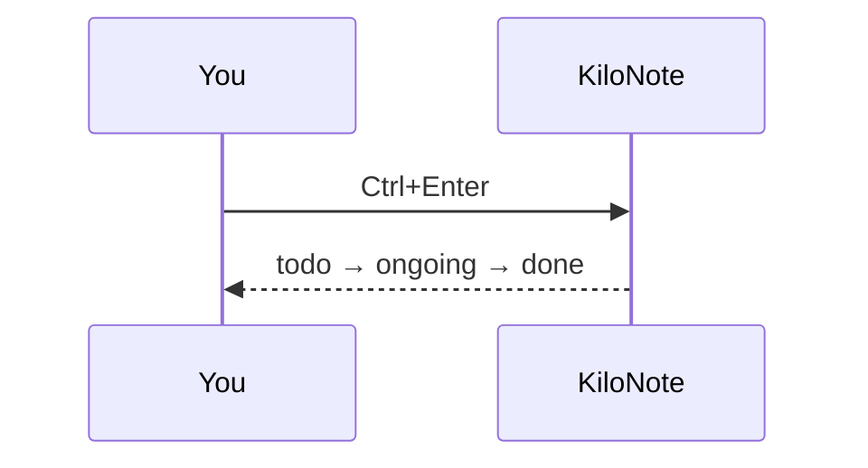

# KiloNote examples

Open this folder in KiloNote (**Ctrl+Shift+O**), then try each file.
Most of them have a second view: click the **Preview** or **Tree** button at the
right of the tabs, or press **Ctrl+Shift+V**.

| File | What to try |
|---|---|
| `README.md` | This note: **Preview** shows it rendered, task statuses included |
| `page.html` | **Preview**: the page, in a sandbox (its script never runs); the pencil button edits its text in place |
| `logo.svg` | **Preview**: the drawing |
| `config.json` | **Tree**: hover, click, double-click a value to change it |
| `services.yaml` | **Tree**: several documents, anchors, multi-line values |
| `minified.json` | **Shift+Alt+F** formats it (then **Tree**) |
| `broken.json` | **Tree** shows the error; *Go to* jumps to it |
| `layout.xml` | **Tree** (elements, attributes, text); **Shift+Alt+F** formats it |
| `flow.mmd` | **Diagram**: a Mermaid flowchart, zoom and *Save as SVG* |
| `schema.sql` | **Schema**: entity-relationship diagram, tables, data, statements |
| `styles.css` | **Shift+Alt+F** formats it |
| `report.py`, `query.sql`, `deploy.ps1`, `build.bat` | Syntax coloring |

## Tasks in a Markdown note

- prepare the demo for the Acme team @2026-12-01 - ongoing
- review the pull request #backend - todo
- update the onboarding guide - done [2026-11-02]

Press **Ctrl+Enter** on a line to change its status, **Ctrl+Shift+U** to set a due date.

## A table to align

Select nothing and press **Shift+Alt+F**: the columns line up.

|Service|Port|Status|
|:--|--:|:-:|
|api|8080|ok|
|worker|9000|degraded|
|web-frontend|443|ok|

## A diagram in a note



## Code, quotes and lists

```python
def greet(name: str) -> str:
    return f"Hello, {name}!"
```

> A note is a plain text file: KiloNote never locks it in.

1. Open a file
2. Look at it twice
   - once as text
   - once as a preview or a tree

- [x] read this file
- [ ] open `config.json` in the tree view

[KiloNote on GitHub](https://github.com/Damoy/kilonote) (Ctrl+click in the editor, a
click in the preview: it opens in your browser).
